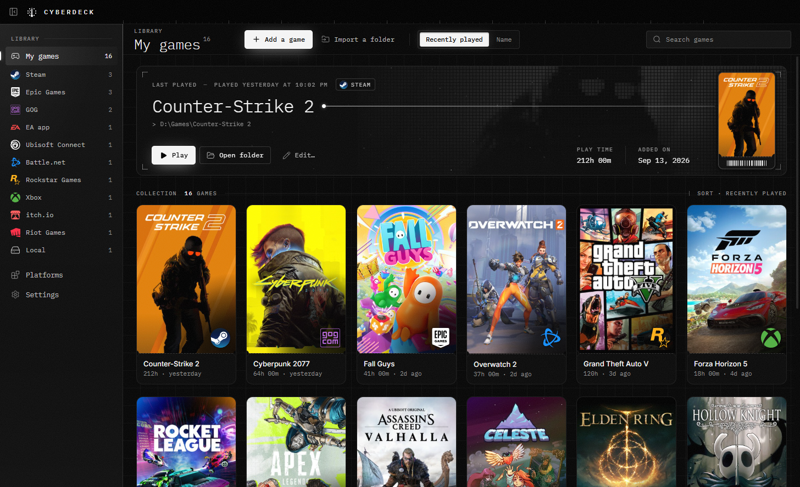
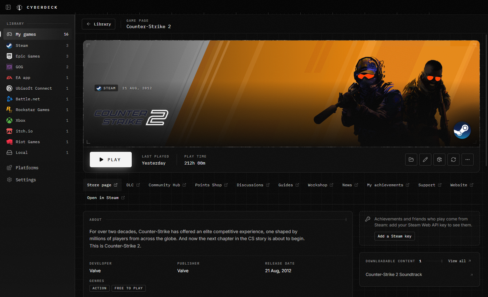

# CyberDeck

All your PC games in one library: Steam, Epic Games, GOG, EA, Ubisoft Connect, Battle.net, Rockstar, Xbox / Microsoft Store, itch.io, Amazon Games, Riot, plus the games you installed yourself. No more wondering which launcher a game is on: its logo tells you, and you just click **Play**.

Free, no ads, no account, no telemetry. For Windows 10 and 11 (64-bit). Available in English and French.



## Install (2 minutes)

1. Open the **[Releases](https://github.com/Cyberkid667/CyberDeck/releases/latest)** page.
2. Under **Assets**, click **`CyberDeck-x.y.z-Setup.exe`** to download it.
3. Double-click the downloaded file.
4. Windows may show **"Windows protected your PC"**: click **More info**, then **Run anyway**. Every small app without a paid code-signing certificate gets this message.
5. That's it: CyberDeck installs itself, opens, and adds a Desktop shortcut. Your games show up within seconds.

No administrator rights needed: the app installs for your Windows account only.

**Update**: when a new version is out, CyberDeck tells you (a message and an "Update" button at the top of the window). Click **Download**, then run the new installer: your library is kept.

**Uninstall**: Windows Settings › Apps › CyberDeck › Uninstall. Your data stays in `%APPDATA%\CyberDeck`: delete that folder to remove everything.

## Features

- **One library**: covers, the platform's logo on every game, filters by platform, sort by recently played or by name, search.
- **Play**: each game starts through its own launcher (Steam, Epic…), or directly for local games. CyberDeck shows "In game" while you play and counts your play time.
- **Automatic detection**: games installed by your launchers appear by themselves, and the list updates when you install or uninstall one.
- **Game pages**: click a game to see its page: big artwork, description, news, DLC, and links to its store, community hub, discussions, guides, workshop and support pages. With your Steam API key, also your achievements and the friends who play it.
- **Download progress**: follow a Steam download or update from CyberDeck (progress, speed, time remaining).
- **Uninstall games**: right-click a game › Uninstall. CyberDeck goes through the game's launcher (Steam…) or its own uninstaller, and never deletes a folder by itself.
- **Your other games**: add a game by hand, or import a whole folder (for example `D:\Games`) with a review window before anything is added.
- **Owned Steam games** (optional): with your Steam Web API key, you also see games you own but haven't installed.
- **Torrents** (optional, off by default): a small torrent client, to enable in Settings.
- **Languages**: English by default, French in Settings › Language.



## Supported platforms

| Platform | What is read on your PC |
| --- | --- |
| Steam | all your Steam libraries, on every drive |
| Epic Games | the Epic launcher's manifests |
| GOG Galaxy, EA app, Ubisoft Connect, Rockstar, Amazon Games, Riot, itch.io | the games registered by each launcher |
| Battle.net | the list of games installed by the Battle.net agent |
| Xbox / Microsoft Store | games installed from the Store or Game Pass |

A game is missing? Add it by hand with **Add a game**, or open an issue on GitHub with the launcher and game name.

## Privacy

- **No telemetry**: no crash reports, no analytics.
- **Updates**: at startup and every 12 hours, CyberDeck asks GitHub (`api.github.com`) for the latest published version number. Nothing is downloaded or installed without you. Can be turned off in Settings.
- To find covers, **game names** are sent to the Steam store, then to Wikipedia if Steam finds nothing. Epic covers are read from the Epic launcher's cache.
- **Only if you enter your Steam API key**: the key and your SteamID are sent to Valve to read your game list. The key is encrypted on disk by Windows.
- **Game pages**: opening a game's page asks the Steam store and news API about that game (its Steam id), or Wikipedia when it isn't on Steam, and loads their images. With your Steam API key, your achievements and your friends list are read from Valve too. Pages are cached in `%APPDATA%\CyberDeck\details`.
- Other platforms are read **on your PC only**.
- **Torrents**: as with any torrent client, your IP address is visible to other peers.
- Everything else (library, settings, log) stays in `%APPDATA%\CyberDeck`.

## Build it yourself

You need [Node.js](https://nodejs.org) 22 or newer.

```bash
npm install
npm run build      # builds into out/
npx electron .     # runs the built app
npm run dist       # creates the installer in dist/
```

To test without touching your real library: `CYBERDECK_USER_DATA=<folder>` runs the app with a separate profile. Screenshot tools are in `tests/tools`.

Electron, React and TypeScript, built with electron-vite. Torrent engine: WebTorrent, in a separate process, started only when torrents are enabled.

## License

MIT, see [LICENSE](LICENSE).

Platform logos come from [Simple Icons](https://simpleicons.org) (CC0). They are trademarks of their respective owners, shown only to indicate where a game is installed. CyberDeck is not affiliated with any of these companies.
